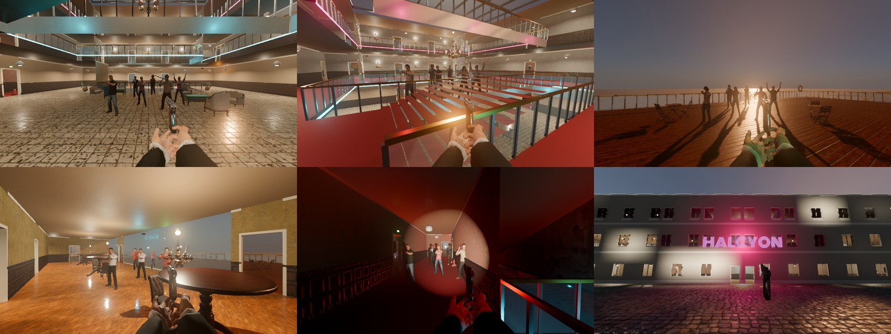

# Halcyon

A first-person shooter built from scratch for [BOLDBLASTER](https://github.com/samuelling/BOLDBLASTER) (the simulation testbed for an open fMRI dataset of people playing a game), designed around the models the earlier
rounds tested (see DESIGN.md). A gang holds a derelict 1960s seaside hotel; you find guests and walk
them out. Every mechanic runs inside the same fight:

- people step into the corridor every 4-10 s, in groups of 1-5, and you must decide whether to
  shoot or hold (drift diffusion, numerosity)
- each flight of stairs carries a slowly drifting ambush risk (a restless bandit for reinforcement
  learning)
- the gang opens and shuts the security doors, so routes change (map updating)
- after a pickup the power often fails, and you walk back by torchlight (path integration)
- an open atrium, a ballroom and a terrace (grid code), varied lighting and PBR materials (early
  visual models)

There are two builds of the same hotel and the same rules:

| | Where | What it is |
|---|---|---|
| **Godot 4.7** (the main game) | repo root: `project.godot`, `game/` | Forward+ renderer: real lamps, sun and neon, global illumination (SDFGI), volumetric light, reflections, clothed people with motion-captured-style animation, your own body and hands on the pistol |
| **Browser** (the lite version) | `index.html`, `web/` | three.js, baked lighting; runs on anything, phones included |

**Play the Godot build:** install [Godot 4.7.x](https://godotengine.org/download) (standard, not .NET), clone this
repo, open `project.godot` (the first open imports the assets, a few minutes), press F5. WASD move,
Shift run, mouse look, left button fire, right button aim, R reload, E "come with me", F torch,
Esc pause, F11 full screen. A gamepad works too (sticks, triggers, A/X/Y).

**Play the browser build:** `index.html` at the repo root (GitHub Pages:
https://samuelling.github.io/Halcyon/; locally `python3 -m http.server` here).

**What changed in the Godot build (round 12 retune):**
- one group is one decision: a group is all armed or all unarmed, and groups are spaced so calls are
  about 10 s apart (they were 2.8 s apart)
- every rescue starts upstairs, so each one crosses stairs at least twice; every landing ends in an
  ambush or a supply crate (110-130 crossings an hour, from 82)
- the power fails right after a pickup and comes back when you reach the flight you came up by
  (dark about 10% of the time, from 20%)
- the way out alternates between the front doors and the far end of the pool terrace
- who is a gunman is told by the hands (pistol aimed or held low, a phone, hands up), never by the
  clothes: every role draws from the same pool of people
- health comes back after six quiet seconds; first aid and ammunition wait at safe landings

**Three places to play** (keys 1, 2, 3 on the title card; `level=hotel|gardens|service` for the bot and harness):

| Level | What it is | What it asks of you |
|---|---|---|
| The hotel | three floors round an atrium, a terrace over the sea, dusk | the full game: stairs with hidden risk, security doors, blackouts |
| The gardens | open ground: lawns, hedges, low walls, four pavilions, late-afternoon sun | long sight lines and long shots; people are seen coming from 25 m and more; no stairs, no blackouts |
| The service level | two floors of 2 m corridors and small rooms under the hotel, cold tube light | tight quarters: every corner is close, thirteen security doors, four narrow flights, frequent blackouts |

The hotel is exported from the browser build's generator; the other two are made in code
(`game/levelgen.gd`) and their geometry is built from the plan (`Level._build_native`), so a new
level is a page of GDScript: rooms, edges, flights, lamps, props, and a small table saying where
you start, the ways out, and where guests wait.

**Layout:**
- `game/` GDScript: `plan.gd` (walkable plan, sight lines, routes), `levelgen.gd` (the gardens and the
  service level), `level.gd` (building, lights, sky, sea, neon), `game.gd` (player, pistol, director, logging), `actor.gd`, `chars.gd` (avatars,
  retargeted animation, arm IK), `view.gd` (first-person body and pistol), `fx.gd`, `hud.gd`,
  `bot.gd` (the simulated player), `sim.gd` (headless logic runs), `main.gd`
- `level/` the building exported from the browser build's generator (`tools/export_level.mjs`)
- `tools/` `setup_retarget.gd` and `setup_textures.gd` (import settings), `make_sfx.py` (the sounds)
- `web/` the three.js sources (`node build.mjs` there rewrites `index.html`)

**Bot and harness (BOLDBLASTER):**
- logic only, fast: `godot --headless --path . --script game/sim.gd -- seed=1 minutes=20`
- rendered run: `godot --path . --resolution 384x288 --fixed-fps 10 -- scan=<prefix> seed=1 frames=3000`
  writes `<prefix>_rgb.u8` (192x144 frames), `_log.jsonl`, `_events.json`
- watch the bot play: `godot --path . -- bot=1`

## Credits

- Materials, props, sky, pistol: [Poly Haven](https://polyhaven.com), CC0 (`assets/CREDITS_polyhaven.txt`)
- People: [Microsoft Rocketbox](https://github.com/microsoft/Microsoft-Rocketbox) avatars, MIT licence
  (Gonzalez-Franco et al., 2020, "The Rocketbox library and the utility of freely available rigged
  avatars", Frontiers in Virtual Reality)
- Animation: [Quaternius](https://quaternius.com) Universal Animation Library 1 and 2, CC0
- Fonts: Tilt Neon, Monoton, Rajdhani (SIL Open Font Licence, `assets/fonts/`)
- Sounds: synthesised by `tools/make_sfx.py`
- Engines: [Godot](https://godotengine.org) and [three.js](https://threejs.org), both MIT
- Browser build only: Soldier.glb and Michelle.glb from the three.js examples (Mixamo characters,
  free to use under Adobe's terms; not CC0)

## What the first hour showed (BOLDBLASTER round 11)

Twelve 5-minute bot runs, every model refitted against simulated brains:
- **Worked:** navigation and spatial memory were the best of any game tested (boundary distance
  .97, grid orientation .65, place forgetting from BOLD .90), and the puzzles are recoverable from
  behaviour (map updating .63, path-integration distance gain .82, stair learning rate .58).
- **Didn't:** decisions from BOLD. Each person in a group became a separate call, so calls came
  2.8 s apart and drift diffusion and value learning were unreadable from BOLD. Blackouts took 20%
  of the hour and the dim interior cost contrast tuning.
- **Next tuning:** one call per group at least 6 s apart, more and shorter stair trips with an
  outcome on every landing, shorter blackouts ending at a stairwell, more time on the terrace.

Details: README and dashboard (Experiment 10) in samuelling/BOLDBLASTER.
